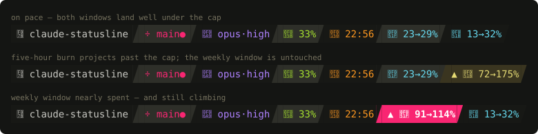

# claude-statusline

[](https://github.com/jasonm4130/claude-statusline/actions/workflows/ci.yml)
[](https://github.com/jasonm4130/claude-statusline/releases)
[](go.mod)
[](LICENSE)

A status line for [Claude Code](https://claude.com/claude-code) that tells you how hard you can spend, not just how much you have spent. It reads the statusline JSON payload on stdin, writes one ANSI-coloured line to stdout, and always exits 0. Go standard library only, no configuration file, no dependencies.



The rate-limit segments project each window forward to its reset. `5h 13%→32%` means the current burn ends the five-hour window at 32% — spend freely. `▲ 5h 72%→175%` means the cap arrives before the reset does.

## Install

Download a binary from [the latest release](https://github.com/jasonm4130/claude-statusline/releases/latest):

```sh
tar -xzf claude-statusline_*_darwin_arm64.tar.gz
install -m 755 claude-statusline_*/claude-statusline ~/.local/bin/
```

Or build from source, which needs nothing but a Go toolchain:

```sh
go install github.com/jasonm4130/claude-statusline@latest
```

## Configure

Point `~/.claude/settings.json` at the binary:

```json
"statusLine": { "type": "command", "command": "~/.local/bin/claude-statusline", "refreshInterval": 30 }
```

`refreshInterval` (Claude Code 2.1.323 and later) re-runs the command every N seconds on top of the event-driven updates. It is optional; the line is built to stay true without it. 30 is a good value: it lets `cache cold` and the falling pace projections catch up during a quiet spell, and a render in a dirty repo costs about 2.5 ms once the dirty check is cached (see [Latency](#latency)).

Segment separators use the powerline glyph U+E0BC, so the terminal needs a [Nerd Font](https://www.nerdfonts.com). Colours are 24-bit truecolor.

The context segment measures usage against the auto-compact window rather than the raw context size, because auto-compact is the limit you actually hit. It resolves `CLAUDE_CODE_AUTO_COMPACT_WINDOW` if set, then the session model's `modelSettings.<model id>.autoCompactWindow`, then the global `autoCompactWindow`, both from `settings.json` in `CLAUDE_CONFIG_DIR` or `~/.claude`, and falls back to the model's context window size.

Set `CLAUDE_STATUSLINE_SNAPSHOT` to a file path to keep the latest payload that carries `rate_limits`. The raw stdin bytes are written atomically (a `0600` temp file in the same directory, then a rename; a missing parent directory is created `0700`). A payload without `rate_limits` never overwrites an existing snapshot, and any error is silent and never affects the rendered line or exit code.

## Segments

Each segment disappears when its data is absent, and the alternating backgrounds re-alternate around the gap, so a missing segment never leaves two same-coloured neighbours touching. If stdin cannot be parsed at all, the line degrades to the basename of `$PWD` rather than blanking.

| Segment | Example | Source |
|---|---|---|
| directory | `claude-statusline` | payload `workspace.current_dir`, then `cwd`, then `$PWD` on a parse failure |
| git | `main*` | `.git/HEAD` read directly; `*` from `git status --porcelain`, cached briefly per repo |
| model | `opus·high`, `opus·high ⚡` in fast mode, or `⤷ explore·sonnet·med +adv opus` while a subagent works, with `(3 agents)` after a fan-out | payload `model`, `effort` and `fast_mode`, or the transcript when a subagent wrote the last turn |
| context | `132k/400k 33%` | payload `context_window` against the auto-compact window |
| cache | `cache→22:56`, `cache cold · 66k recache`, `cache→22:56 ✗2` | payload `prompt_cache`, else prompt-cache expiry parsed from the transcript |
| weekly limit | `7d 23%→29% Sun` | payload `rate_limits.seven_day` |
| session limit | `5h 13%→32%` | payload `rate_limits.five_hour` |

## Design notes

By default Claude Code runs the statusline command on state change, never on a timer. Measured idle, it goes 60 seconds or more between invocations. Since 2.1.323 a `refreshInterval` setting can add a timer, but it is opt-in, and the binary cannot tell from its input whether one is configured. Everything on the line therefore still has to stay **true while frozen**, and that single constraint drives most of the decisions below. A timer only shortens how long a render sits frozen; it never licenses a claim that would be false without one.

### Rate-limit pace

Each window has a known length, so `resets_at` fixes its start and the fraction already elapsed is arithmetic. Dividing used percent by that fraction projects where the window lands at reset if the average burn so far continues. Under 100% is headroom. At or over 100% the segment warms and takes a `▲`, because the cap will arrive before the reset does.

Two things follow from the definition, and both matter when reading the number. The projection is a **cumulative average**, so it has no memory of shape: a window where you burned 40% in twenty minutes and one where you dripped 40% across three hours project identically. And `used_percentage` is the server's figure, from the claude.ai usage endpoint, so the unit is percent of quota rather than tokens — already weighted for model, cache, and everything else the server weighs, and counting your usage on other machines too.

Freezing is safe here, which is why the projection is allowed on the line at all. While a session sits idle, elapsed grows and used does not, so the true projection only ever falls. A stale reading overstates the burn and can never invite spend the window cannot cover.

The projection is suppressed below 5% elapsed, where used-over-elapsed is dominated by whatever landed in the first few minutes, and whenever `resets_at` is missing or already past. Those cases fall back to bare usage.

Each window renders as its own segment so that it can carry its own colour. A hot five-hour window should not repaint a healthy weekly one.

### Which agent spoke last

The payload names the session model, so it does not move while a subagent works. The transcript moves. A subagent writes its own file under `<transcript>/subagents`, and every assistant record there carries the agent type, the model and the effort. The segment compares the newest assistant record in the main transcript with the newest one in the freshest subagent file, then names whichever agent wrote last.

That claim is about the past, so it survives a frozen render. A live "a subagent is running" badge would not, because the statusline is called on state change and the badge would outlive the agent. Measured here with a logging wrapper, the command ran three times inside a 23-second subagent run, so the label does appear while the agent works.

The advisor model rides in the same segment, and only when it differs from the model that wrote the last turn. Advisor and session model are usually the same, so a permanent label would repeat one word all day. The case worth seeing is the mismatch: a sonnet subagent advised by opus.

Parallel agents get a count. The newest record still names the label, so a fan-out of four names whichever of them wrote last, and `(4 agents)` follows it: the number of subagent transcripts written since the main agent's own last turn. That window is chosen to keep the claim about the past. It cannot become false while frozen, only incomplete, and it needs no clock: sequential agents always have a main-agent turn between them, so only agents working alongside each other share it. The count appears only on a subagent label and only above one.

### Prompt-cache expiry

The cache segment shows an absolute clock time rather than a countdown. A countdown, or a warm/expired badge, freezes mid-session and quietly becomes a lie — exactly when a quiet session is when you want to know. `cache→22:56` is still true at 23:30, because the arithmetic happened once and does not decay. The one claim safe to render is the negative one, so once the clock has passed, the segment reads `cache cold` and stays honest: expiry only moves forward when a new request lands, and a new request re-renders.

Claude Code 2.1.323 and later send a `prompt_cache` object in the payload, and the segment prefers it: `expires_at` is the clock, with no inference. The `warm` flag is deliberately ignored, since it is as stale as any other frozen render; the segment is cold when `expires_at` is at or before the time of rendering. A cold segment appends the cost of resuming, `recache_tokens_if_cold`, as `cache cold · 66k recache`. The transcript path below remains the fallback when `prompt_cache` is absent, `caching_observed` is false, or `expires_at` is missing.

`misses` counts misses Claude Code did not plan for; planned rebuilds go to `expected_rebuilds` and are never shown (a live payload with one expected rebuild and zero misses suggests the two are disjoint). Any `misses > 0` appends `✗N`, plus `last_miss_cause` when it is eight characters or fewer, and warms the segment for 15 minutes after `last_miss_at` (or indefinitely when that time is unknown). After that the count stays but the amber fades. The count is cumulative, so it is still true when frozen.

In the transcript fallback, both inputs come from the `transcript_path` the payload already supplies. The timestamp is the newest request's, since a cache read refreshes the entry's TTL. The tier is the newest request that actually wrote a cache entry, read from `message.usage.cache_creation` — `ephemeral_1h_input_tokens` against `ephemeral_5m_input_tokens` — so the TTL is measured, never assumed. Only the last 512 KB of the transcript is read, from the end, with the partial first line dropped.

### Latency

Nothing on the line is allowed to make the prompt wait. The git branch comes from reading `.git/HEAD` directly rather than shelling out. The dirty marker is the one subprocess, and it runs under a 150 ms timeout and is dropped rather than waited on. It passes `--no-optional-locks`, so it never rewrites the index or holds `.git/index.lock` against git commands running in the same repo.

The dirty answer is cached per repo in a small file under the user cache directory (`~/Library/Caches/claude-statusline` on macOS, `~/.cache/claude-statusline` on Linux), keyed on the git dir and the size and modification time of `.git/index`, `HEAD` and the HEAD reflog. Staging, committing, checking out, resetting and stashing all move that fingerprint, so they show on the next render. A plain edit to a tracked file does not, so the cached answer also expires: a clean answer after 5 seconds, a dirty one after 2 minutes, because clean-to-dirty is exactly the edit the fingerprint misses while dirty-to-clean almost always goes through git. Any failure, and any git timeout, falls back to running git, and a timeout is never cached. Measured with `hyperfine` on an M5 in a dirty repo, a render dropped from 12.7 ms to 2.5 ms; in a clean repo, from 13.7 ms to 2.4 ms on a cache hit, with a miss costing the same as before. On a 30-second timer a dirty repo skips git on three ticks in four, at the cost of an edit undone by hand keeping its `*` for up to 2 minutes; a clean repo still runs git on every tick.

Two file reads land on the same path. The main transcript is read once and serves both the cache clock and the agent label. The freshest subagent file is read only when its modification time beats the main agent's last turn. Both reads are capped at 512 KB taken from the end of the file. Measured against a session holding 100 subagent files of 560 KB each, the whole lookup costs 0.28 ms on an M5.

`go test -bench Render -benchmem` renders a realistic payload (400-line transcript, no git) in about 89 µs and 96 allocations per call on an M-series Mac. That is the in-process cost only; the process as a whole measured about 2.5 ms without git and 14.5 ms with it, so the git dirty check dominates and process start-up is the rest. Folding the snapshot tee into the binary (`CLAUDE_STATUSLINE_SNAPSHOT`) replaces a bash wrapper that added about 11 ms per render.

## Palette

Theme: Cyber-Monokai, 24-bit truecolor. Backgrounds alternate between `#171815` and `#2E2F29` by render position among the segments actually present; each segment's identity lives in its text colour.

| Segment | Colour |
|---|---|
| directory | `#C8C8C2` |
| git | `#F92672` |
| model | `#AE81FF` |
| context | `#A6E22E` |
| cache | `#FD971F` |
| limits | `#66D9EF` |

The directory segment is the exception to identity-as-text-colour: its text is `#C8C8C2`, while `#75715E` serves as its muted accent.

Context and rate-limit segments each key on their own percentage. From 60% to 84% a segment goes warming — background `#3A3520`, text `#E6DB74`. At 85% and above it goes critical: background `#F92672` flooded with bold `#FFFFFF`. A cold cache borrows the warming style. Where two adjacent segments share a state, and therefore a background, the separator between them darkens to `#2A2618` or `#C71F5B` to keep its shape visible.

A projection past 100% warms a segment and adds `▲`. The glyph is not decoration: warming amber also means "used a lot", the two conditions are different, and a glyph survives a colourblind reader and a terminal with a mangled palette.

## Development

```sh
go test ./...              # unit tests and the demo-image golden check
golangci-lint run ./...
goreleaser release --snapshot --skip=publish --clean
```

The demo image at the top of this README is generated from real render output, not drawn by hand. `TestDemoSVG` builds sample payloads, runs them through the same `draw()` the terminal gets, parses that ANSI back into coloured runs, and emits SVG. CI regenerates it and fails on any diff, so a palette or layout change cannot ship alongside a screenshot that no longer matches what the binary prints.

```sh
go test -run TestDemoSVG -update .    # after an intentional visual change
```

Releases are tag-driven. Pushing a `v*` tag builds four binaries (darwin and linux, amd64 and arm64), attaches checksums and per-archive SBOMs, and publishes a GitHub release.

## License

[MIT](LICENSE)
